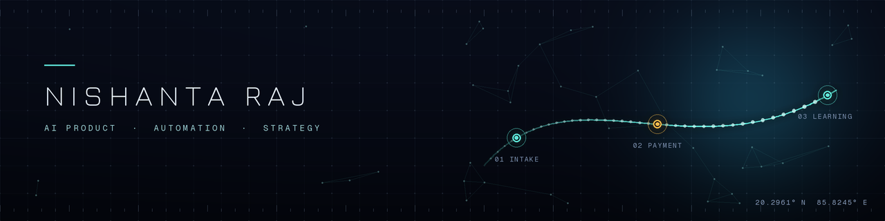

# Nishanta Raj

**Head of AI Product Automations & Strategy at Learn with Leaders** · New Delhi, India

I design the operating system of an EdTech company: one trusted database for every programme, books that read per programme, payments that reconcile themselves, and reports the founders receive each morning without anyone building them.

---

## What I own

| Remit | What it means in practice |
|---|---|
| **Data and backend architecture** | One central database in place of a sheet per programme. Incoming data lands first and is validated before it is trusted. Role-based access, consent and audit built in, not bolted on |
| **Financial streamlining and reporting** | Multi-currency books designed around programmes, advance fees held as a liability until delivered, one programme code shared by the books, the database and the reports, and a finance console for founders |
| **Process design** | Taking an unwritten habit, writing the rule, building the tool, and getting people to use it |
| **Product** | One application portal and custom checkout behind every digital programme, a learner portal and LMS, an affiliate platform, a finance console. Architected by me, built with Lovable on React and Supabase |
| **Automation and AI** | Staged email and WhatsApp reminders, daily, weekly and quarterly reports that run on their own, and AI calling agents per region and programme with consent, suppression and kill switches |

## How the organisation changed

| Before | After |
|---|---|
| A sheet per programme, the same school spelled several ways | One database with explicit links between people, organisations, applications and payments |
| Payment links matched to students by hand | Checkout that carries a programme code, a webhook, and a reconciliation job that flags what it cannot match |
| Finance reconciled programme by programme | One coded taxonomy across the books, the database and the reports |
| Reports built by hand | Daily application and payment reports, a weekly financial overview and a quarterly programme-wise profit and loss that arrive on their own |
| A site and form rebuilt for each programme | One application portal and shared catalogue that every programme site plugs into |
| A gap after a student paid | A learner portal and LMS reading from the same database |

The full picture is in [Operating model, before and after](https://github.com/nishantaraaj-prog/case-studies/blob/main/01-Organisation-Reshaped/Operating-Model-Before-And-After.md).

## Platforms I architected and built

Design and product logic are mine. I used AI to build quickly, and I make the architecture decisions.

| Platform | Role in the organisation |
|---|---|
| Application Portal | The front door and central admin for every digital programme: catalogue-driven forms, custom checkout, promo engine, automated reminders |
| Learner Portal and LMS | Student, mentor and admin portals, certificates, rewards, and an enrolment engine |
| Finance Console and Founder 360 | Cash position, programme profitability, overheads, vendor bills and a cross-platform founder view |
| Effort First | Deploys AI calling agents by region and programme, with consent-gated follow-up |
| Affiliate Platform | Partner and school portals with attribution, earnings and payouts |

## Selected work

Write-ups live in [case-studies](https://github.com/nishantaraaj-prog/case-studies). The company's code, data and figures stay with the company, so each one covers the problem, the design and the trade-offs.

| Area | Read |
|---|---|
| Organisation | [Operating model, before and after](https://github.com/nishantaraaj-prog/case-studies/blob/main/01-Organisation-Reshaped/Operating-Model-Before-And-After.md) |
| Data and backend | [Platform estate architecture](https://github.com/nishantaraaj-prog/case-studies/blob/main/02-Data-And-Backend/Platform-Estate-Architecture.md) · [Unified data architecture](https://github.com/nishantaraaj-prog/case-studies/blob/main/02-Data-And-Backend/Unified-Data-Architecture.md) · [Backend design principles](https://github.com/nishantaraaj-prog/case-studies/blob/main/02-Data-And-Backend/Backend-Design-Principles.md) |
| Finance | [Financial streamlining and reporting](https://github.com/nishantaraaj-prog/case-studies/blob/main/03-Finance/Financial-Streamlining-And-Reporting.md) · [Finance console](https://github.com/nishantaraaj-prog/case-studies/blob/main/03-Finance/Finance-Console.md) · [Automated financial reporting](https://github.com/nishantaraaj-prog/case-studies/blob/main/03-Finance/Automated-Financial-Reporting.md) · [Programme code convention](https://github.com/nishantaraaj-prog/case-studies/blob/main/03-Finance/Programme-Code-Convention.md) |
| Product | [Application portal](https://github.com/nishantaraaj-prog/case-studies/blob/main/04-Product/Application-Portal.md) · [Application-to-payment journey](https://github.com/nishantaraaj-prog/case-studies/blob/main/04-Product/Application-To-Payment-Journey.md) · [Learner portal and LMS](https://github.com/nishantaraaj-prog/case-studies/blob/main/04-Product/LMS-And-Portals.md) · [Affiliate platform](https://github.com/nishantaraaj-prog/case-studies/blob/main/04-Product/Affiliate-Platform.md) · [Lovable build portfolio](https://github.com/nishantaraaj-prog/case-studies/blob/main/04-Product/Lovable-Build-Portfolio.md) |
| Automation and AI | [AI calling agents](https://github.com/nishantaraaj-prog/case-studies/blob/main/05-Automation-And-AI/AI-Calling-Agents.md) · [AI lead agents and reporting](https://github.com/nishantaraaj-prog/case-studies/blob/main/05-Automation-And-AI/AI-Lead-Agents-And-Reporting.md) · [Daily automations with Apps Script](https://github.com/nishantaraaj-prog/case-studies/blob/main/05-Automation-And-AI/Daily-Automations-With-Apps-Script.md) |
| Process design | [Building processes from scratch](https://github.com/nishantaraaj-prog/case-studies/blob/main/06-Process-Design/Building-Processes-From-Scratch.md) |

## Runnable code

Original code with invented data, written from scratch to show the patterns. None of it is the company's implementation.

| Repository | What it shows |
|---|---|
| [supabase-backend-patterns](https://github.com/nishantaraaj-prog/supabase-backend-patterns) | Landing layer, money in minor units, consent, time-limited grants and row-level security, with tests that run on real Postgres |
| [programme-finance-reporting](https://github.com/nishantaraaj-prog/programme-finance-reporting) | Programme-coded profit and loss with deferred revenue and multiple currencies |
| [payment-reconciliation-template](https://github.com/nishantaraaj-prog/payment-reconciliation-template) | Matching payments to applications, safe to re-run |
| [apps-script-daily-ops-toolkit](https://github.com/nishantaraaj-prog/apps-script-daily-ops-toolkit) | Daily snapshot, staged reminders, duplicate-safe CSV import |

## How I work

1. Map the manual process end to end.
2. Get the data into one trusted place.
3. Put money through it with identifiers that survive.
4. Make the reports read from it.
5. Automate the follow-up last, and measure each stage so it can be questioned.

I decide the architecture first, then build with AI and Lovable, and I read, write and review the code myself in VS Code and Claude Code. I keep a person in the loop wherever a wrong call is expensive, and I would rather report a modest number I can defend than a big one I cannot.

## Toolkit

| Area | Tools |
|---|---|
| Product | Lovable, React, TypeScript, Tailwind |
| Engineering workflow | VS Code, Claude Code, Git |
| Data and backend | Supabase (Postgres, Edge Functions, row-level security) |
| Finance | Xero, multi-currency, tracking categories |
| Payments | Stripe, Razorpay |
| Email and messaging | Resend, WATI (WhatsApp) |
| Automation | n8n, Google Apps Script |
| AI | Claude, ChatGPT, Google AI Studio |
| Analysis | Python, SQL, Google Sheets |

## Earlier

At Excelerate I built internal tools that took most of the manual work out of an internship operation.

## Connect

[LinkedIn](https://www.linkedin.com/in/nishantaraj/)
